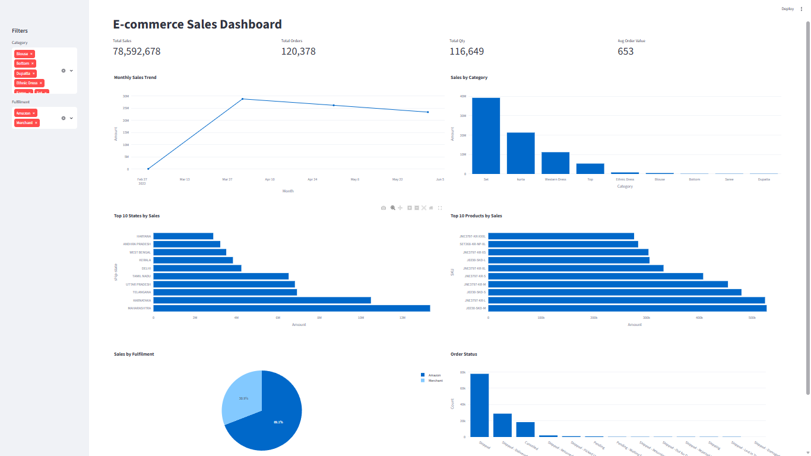

# E-commerce Sales Data Analysis

Analysis of Amazon sales data using Python (Pandas, Matplotlib) with an interactive Streamlit dashboard.

## Analyses
- Category-wise sales
- Monthly sales trend
- Top 10 states, cities and products by sales
- Order status and fulfilment analysis
- Cancellation rate by fulfilment

## Key Insights
- The Set category contributes 49.9% of total sales.
- Sales peaked in April 2022.
- Top states: Maharashtra, Karnataka, Telangana.
- Cancellation rate: Amazon 12.8%, Merchant 17.5%.
- The average order value is 653.

## Dashboard

## How to run
pip install streamlit plotly pandas
streamlit run app.py

## Tools
Python, Pandas, Matplotlib, Plotly, Streamlit